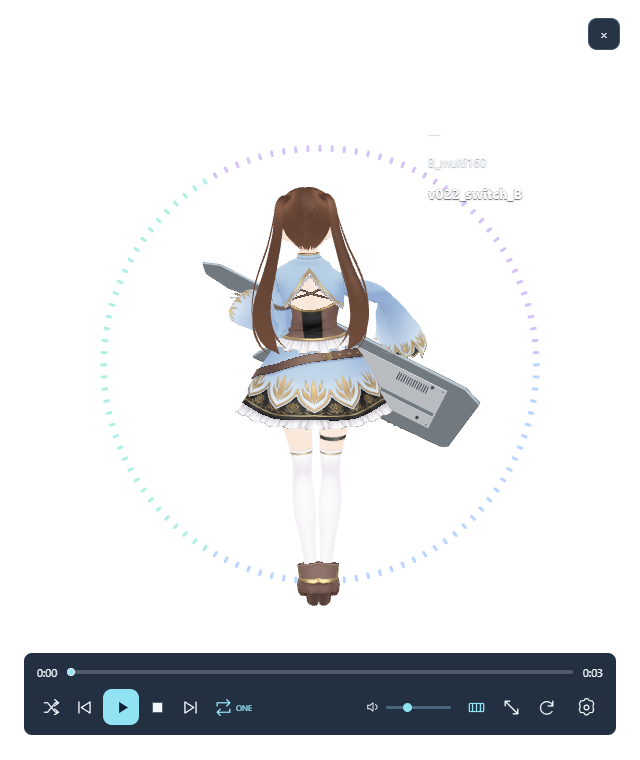

# MGS_MascotPlayer Ver1.0.2 候補

MML・MGSの演奏と、3Dマスコットのモーションを楽しむWindows用プレイヤーです。透明なウィンドウ、プレイリスト、BPM同期、前後シーク、テーマ切替に対応します。

**Ver1.0.2はユーザー承認前の検証候補です。** 自作コードはMIT License（Copyright (c) 2026 rx7nana）。素材と公式アイコンは別条件です。Ver1.0.0の公開済みRelease・タグは維持します。今回のVer1.0.2候補はGitHubへ未反映です。既存v1.0.0・v1.0.1のRelease/タグを変更しません。

## Windowsアプリの入手・起動

Ver1.0.0は[GitHub Releases](https://github.com/rx7nana/MGS_MascotPlayer/releases)で公開済みです。本工程の配布候補はVer1.0.2です。ソースZIPとWindowsアプリZIPは別です。[公開手順](docs/RELEASE.md)に候補ファイルを記載しています。

Windows 11 x64で検証しています。Microsoft Edge WebView2 Evergreen Runtimeが必要です。未導入の場合は[Microsoft公式配布ページ](https://developer.microsoft.com/microsoft-edge/webview2/)から対応するEvergreen Runtimeを導入してください。Runtime・インストーラーは本アプリに同梱しません。オフラインPCでは事前に別途Runtime導入が必要です。

1. WindowsアプリZIPをフォルダごと展開します。EXEだけを移動しないでください。
2. 正当に入手した **MGSC.COM v1.11 / MGSDRV.COM v3.20** をEXEと同じフォルダに配置します。これらは本リポジトリ・配布ZIPに含みません。
3. `MGS_MascotPlayer.exe`を起動し、設定のシステム欄でCOMの認識を確認します。
4. 初期状態はVMD未選択・基準BPM未設定です。VMDモーションは利用者が権利条件を確認して別途用意し、設定から選択して基準BPMを確定してください。VMDがなくてもモデル表示・音楽再生を利用できます。

SmartScreen等の警告が出た場合は、配布元・ファイルのハッシュ・利用者自身の判断を確認してください。WebView2のSmartScreenに関する[利用者通知](docs/PRIVACY_NOTICE.txt)もお読みください。

## プレイリストの保存とCOM未配置時の登録

透過プレイリストへのD&D追加は即時確定します。設定画面の追加・削除・並べ替えは編集用データだけを変更します。「閉じる」の確認で「はい」は内部設定へ保存、「いいえ」は編集を破棄、「キャンセル」は編集を継続します。既存の「保存」ボタンはプレイリストJSONを書き出し、成功した場合に内部設定へも確定します。出力の中止や保存失敗では未保存の編集を保持します。設定画面を開いている間、背後の透過プレイリストは操作できません。

再生中の登録を削除して保存しても、その演奏は最後まで継続します。削除した登録は、1曲リピートを含め次の候補から除外します。空のリストになった場合は現在曲の終了後に停止します。同じファイルの重複登録も個別の登録IDで扱い、シャッフルは表示上の曲順を変更しません。

MGSC.COMがなくても、既存の文字コードデコードで読める非空テキストを、コンパイル未確認のMML候補として登録できます。拡張子は判定条件にしません。COMなしでは文法が有効なMMLかまでは保証できません。暫定ファイル名を表示し、MGSC配置後に従来コンパイル経路で確認できれば内部タイトルへ更新します。MMLのコンパイルはMGSC、音声生成はMGSDRVが必要です。既存MGSの音声生成はMGSDRVだけが必要です。不足時も登録を保持して不足名を案内し、配置後は再生を押して再試行できます。再起動は不要です。

案内文の背景は文章に合う幅で、再生パネルと同じ透過率です。COM不足案内には長いパスを表示しません。透過プレイリスト自体の背景は変えていません。

## 基本操作

- 右上の受け付け領域へMML・MGSをドロップしてプレイリストへ追加します。複数ファイルをまとめて追加できます。追加だけでは自動再生しません。
- MMLは拡張子だけで判定しません。非対応の内容は除外します。ファイルの内部タイトルを表示します。
- 下部へマウスを近づけると操作パネルが現れます。再生・一時停止・再開、前後シーク、音量・サイズ・向きの調整ができます。
- シークバーにはPCM生成済み区間が表示されます。未生成地点へのシークでは待機表示が出ます。生成完了後に音声・モーションの同期を再開します。
- 左上のハンドルで移動します。透明な余白は背面のウィンドウを操作できます。
- 設定からgain（0〜4、標準1）、再生時間・ループ・フェード、VMD、BPM、5色テーマ等を変更できます。曲メタデータの指定がある場合はその指定が優先されます。
- D&Dは領域外へ戻す、またはEscでキャンセルできます。Escによるドラッグキャンセルとアプリ終了は別の操作です。
- 終了は通常の閉じる操作またはAlt+F4です。

設定・プレイリスト等は現在の実装では `%APPDATA%/MGS_MascotPlayer/validation/code-audit-refactor-v016` に保存されます。過去候補と共用する場合があります。アンインストールはアプリを終了して展開フォルダを削除します。保存データを消す場合は先にバックアップし、このアプリの当該フォルダだけを確認してください。

「設定を初期値に戻す」はVMDの選択・パス・基準BPM・BPM履歴も初期化します。通常起動では保存済みVMD設定を復元します。保存先のVMDが見つからない、または読み込みに失敗した場合は選択を解除して案内し、モデル表示を継続します。VMDファイル本体は削除しません。

## 初回起動・設定破損時の修正（v031）

初回起動と設定破損時にも、既存の設定正規化を適用し、プレイリスト各登録のID配列を補完します。既存設定の曲順・ID・ユーザー設定を保持します。保存設定なし、破損設定（有効バックアップあり／なし／両方破損）、ID配列なし旧設定、保存再起動の実起動試験を実施しました。製品処理の変更は初期値読込後の正規化呼出し1行です。

## 検証範囲・制限

Ver1.0.2候補ではPCM24ケース、シーク後・不連続キャッシュのPCM一致、プレイリスト編集/再生順、COM4条件の登録・不足案内・配置後の復帰を確認しました。30分連続試験は1800.458秒、曲切替358回、音声不足0、平均59.99FPS、正常終了でした。300秒曲の未生成150秒地点へのシーク7回は中央値1.429秒（1.410〜1.450秒）です。別時点のVer1.0.1中央値1.475秒は参考比較です。

100/125/150/175%は実操作確認済みです。200%は実機で選べず未検証、開発ツール未導入の別PCも未検証です。今回は30分試験であり、新たな3時間耐久試験を行ったという意味ではありません。先行2試験は状態遷移の試験判定不備で未完走として保持しています。

設定保存の自動試験でOSの一時ファイル置換が1回失敗しました。確定ファイルとメモリは保持され、再試験20回と実操作は成功しています。元の失敗のOS番号は未記録で原因は未確定です。失敗時は編集を保持するため、保存できたことを確認してから終了してください。

## 開発者向け

[ビルド手順](docs/BUILD.md) / [構成と対応](docs/ARCHITECTURE.md) / [第三者通知](THIRD-PARTY-NOTICES.md)

`src/`は表示・入力・再生制御、`native/host/`はWebView2ホスト、`native/audio/`は音声コアです。依存ライブラリの取得と生成物はリポジトリから分離します。EXE・COM・VMD・利用者の曲・個人設定・キャッシュ・検証ログはソース公開対象外です。

## 権利

自作プログラムソースコードは[MIT License](LICENSE)、著作権表示は`Copyright (c) 2026 rx7nana`です。[適用範囲](LICENSE-SCOPE.md)を確認してください。

- 自作モデル・テクスチャ・衣装・アクセサリー・楽器等：[ASSET-LICENSE.md](ASSET-LICENSE.md)。アプリ関連利用と条件付き改変版同梱・有償再配布を許可。素材単体の再配布・販売、無関係な作品への流用は別途許可が必要です。
- 公式アプリアイコン：公式版専用。第三者改変版は[独自アイコンへ差し替え](docs/ICON_REPLACEMENT.md)てください。この条件はコードのMITの権利を制限しません。
- 第三者ライブラリ：各原文・NOTICEを維持します。
- 外部COMや利用者のMML・MGS・VMD：各権利者の条件。本プロジェクトの許諾対象ではありません。
